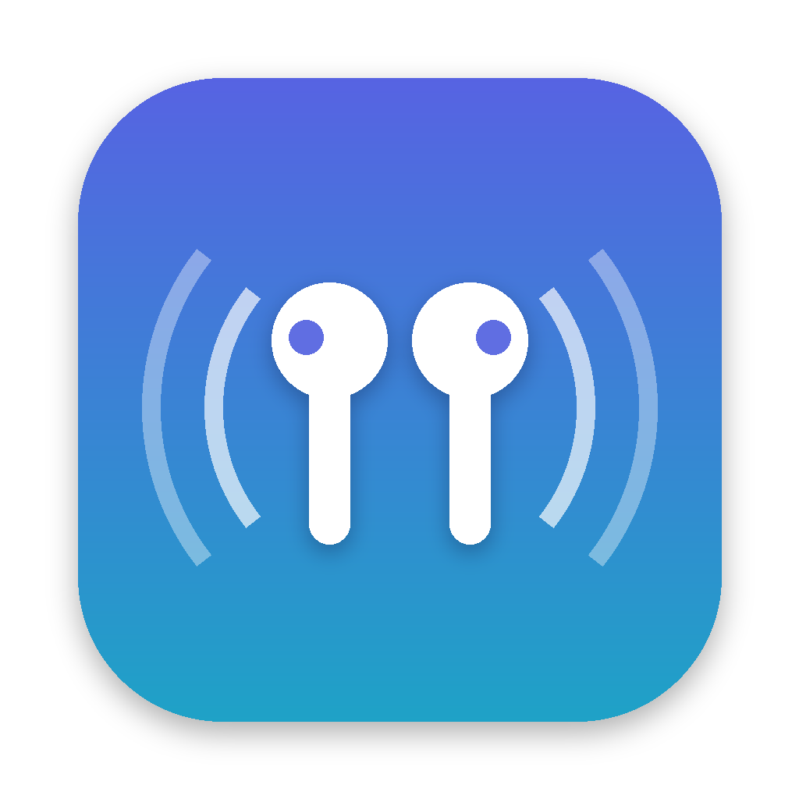
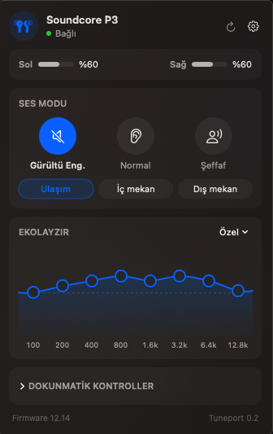

<p align="center">
  
</p>

<h1 align="center">Tuneport</h1>

<p align="center">
  A native macOS menu bar app for Soundcore earbuds.<br>
  Noise cancelling, equalizer and battery — right from your Mac's menu bar.
</p>

<p align="center">
  <a href="#installation">Installation</a> ·
  <a href="#features">Features</a> ·
  <a href="#supported-devices">Supported devices</a> ·
  <a href="#türkçe">Türkçe</a>
</p>

<p align="center">
  
</p>

---

The official Soundcore app only runs on phones. If you use your earbuds with a Mac, you lose access to noise cancelling modes, the equalizer and battery info. **Tuneport** brings them to the menu bar, as a small native SwiftUI app.

## Features

- **Sound modes** — Noise Cancelling, Normal and Transparency, plus ANC types (Transport, Indoor, Outdoor) and transparency types (Full, Vocal)
- **Equalizer** — 8-band curve you can drag directly, and all 22 presets from the official app
- **Battery** — left/right levels and charging state, optional percentage in the menu bar
- **Earbud volume** — change only the earbuds' volume from the panel; your Mac's speakers keep their own level
- **Keeps audio quality high** — keeps your Mac's built-in mic as the default input, so the earbuds never drop to the low-quality "headset" (HFP) profile
- **Switch earbuds** — pick any paired Soundcore device from the panel; Tuneport disconnects the current one and connects the new one
- **17 languages** — switch instantly from the panel, no restart
- **Automatic** — connects as soon as the earbuds connect to your Mac, optional launch at login
- No account, no internet, no tracking

## Installation

### Download

Download the latest `Tuneport-x.y.z.dmg` from [Releases](../../releases), open it and drag **Tuneport** into **Applications**.

The app is not notarized by Apple yet, so the first launch is blocked by Gatekeeper. To open it:
**System Settings → Privacy & Security → "Tuneport was blocked…" → Open Anyway**, or right-click the app → **Open**.

### Build from source

Requires macOS 13+ and the Xcode Command Line Tools (`xcode-select --install`).

```bash
git clone https://github.com/MHMTTPRLK/tuneport.git
cd tuneport
./build.sh install     # build, install to /Applications and launch
./build.sh test        # run protocol tests (no earbuds needed)
./build.sh dmg         # universal (Apple Silicon + Intel) app and DMG
```

On first launch macOS asks for Bluetooth permission — Tuneport needs it to talk to the earbuds.

## Supported devices

| Model | Name | Status |
|---|---|---|
| A3939 | Soundcore Life P3 | ✅ Tested |

More Soundcore models use the same protocol family. If you own another model and want to help, please [open an issue](../../issues).

## How it works

Tuneport talks to the earbuds over a Bluetooth RFCOMM channel (channel 5 on the Life P3), using Soundcore's binary protocol:

```
outgoing:  08 EE 00 00 00 | command (2) | total length (2, LE) | body | checksum
incoming:  09 FF 00 00 01 | command (2) | total length (2, LE) | body | checksum
checksum = sum of all previous bytes, mod 256
```

| Command | Purpose |
|---|---|
| `01 01` | Request full state (battery, firmware, EQ, buttons, sound mode) |
| `06 81` | Set sound mode |
| `02 83` | Set EQ with DRC |

**Finding:** the Life P3 acknowledges and stores EQ values sent with `02 81`, but they have no audible effect. The EQ is only applied by the earbuds' DSP when it is sent with `02 83`, together with the DRC (dynamic range compensation) curve.

### Project layout

```
Sources/Protocol   packet format, state parser, equalizer + DRC
Sources/Device     Bluetooth connection, microphone guard
Sources/UI         SwiftUI menu bar panel
Sources/App        app entry point
Tests              protocol tests built from real packets captured from a Life P3
```

## Translations

Tuneport follows your Mac's language, and you can switch instantly from the 🌐 button in the panel.

Available: English, Türkçe, Deutsch, Español, Français, Italiano, Português (Brasil), Polski, Русский, Українська, Bahasa Indonesia, العربية, עברית, বাংলা, 日本語, 한국어, 简体中文.

Most translations were made by the maintainers, not native speakers — corrections are very welcome.

To add a language, copy `Resources/en.lproj` to `Resources/<language-code>.lproj` (for example `de.lproj`), translate the right-hand side of each line in `Localizable.strings` and `InfoPlist.strings`, add the code to `CFBundleLocalizations` in `Resources/Info.plist` and to the list in `Sources/App/Localization.swift`, and open a pull request. No Swift knowledge needed.

## Roadmap

- [ ] Edit touch controls
- [ ] Gaming mode, touch tones
- [ ] "Find my earbuds" and ear tip fit test
- [ ] More Soundcore models
- [ ] **Live translation (0.4)** — on-device speech recognition + translation of what you hear (videos, calls) or what people say to you, as live subtitles or spoken in your earbuds
- [ ] Signed and notarized releases

## Acknowledgements

Thanks to the [OpenSCQ30](https://github.com/Oppzippy/OpenSCQ30) project for their research on the Soundcore protocol.

## License

[GPL-3.0](LICENSE)

Soundcore and Anker are trademarks of Anker Innovations. This project is not affiliated with or endorsed by Anker.

---

## Türkçe

**Tuneport**, Soundcore kulaklıklar için yerel bir macOS menü çubuğu uygulamasıdır. Resmi Soundcore uygulaması sadece telefonda çalışıyor; Tuneport gürültü engelleme modlarını, ekolayzırı ve pil durumunu Mac'in menü çubuğuna getirir.

### Özellikler

- Gürültü Engelleme / Normal / Şeffaf mod, ANC türleri (Ulaşım, İç mekan, Dış mekan)
- Sürüklenebilir 8 bantlı ekolayzır ve resmi uygulamadaki 22 hazır profil
- Sol/sağ pil durumu, menü çubuğunda pil yüzdesi
- Sadece kulaklığın ses seviyesini ayarlama; Mac hoparlörünün seviyesi değişmez
- Mac'in dahili mikrofonunu varsayılan tutarak kulaklığın düşük kaliteli "telefon" moduna (HFP) düşmesini engeller
- Panelden eşleşmiş Soundcore kulaklıklar arasında geçiş
- 17 dil, panelden anında değiştirilebilir
- Kulaklık bağlanınca otomatik bağlanır, istenirse girişte başlar
- Hesap yok, internet yok, veri toplama yok

### Kurulum

[Releases](../../releases) sayfasından `Tuneport-x.y.z.dmg` dosyasını indir, aç ve **Tuneport**'u **Uygulamalar** klasörüne sürükle.

Uygulama henüz Apple tarafından onaylanmadığı (notarize) için ilk açılışta macOS engelleyecek. Açmak için: **Sistem Ayarları → Gizlilik ve Güvenlik → "Tuneport engellendi…" → Yine de Aç**, ya da uygulamaya sağ tıklayıp **Aç**.

Kaynak koddan derlemek için: `./build.sh install`

### Desteklenen cihazlar

Şu an **Soundcore Life P3 (A3939)** test edildi. Başka bir Soundcore modelin varsa test etmek için [issue açabilirsin](../../issues).
